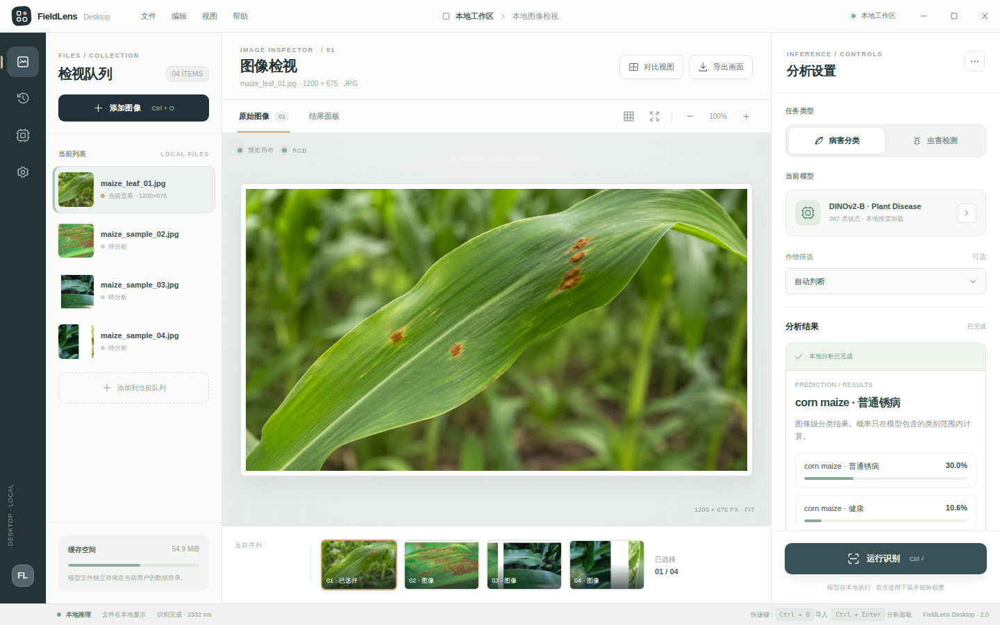
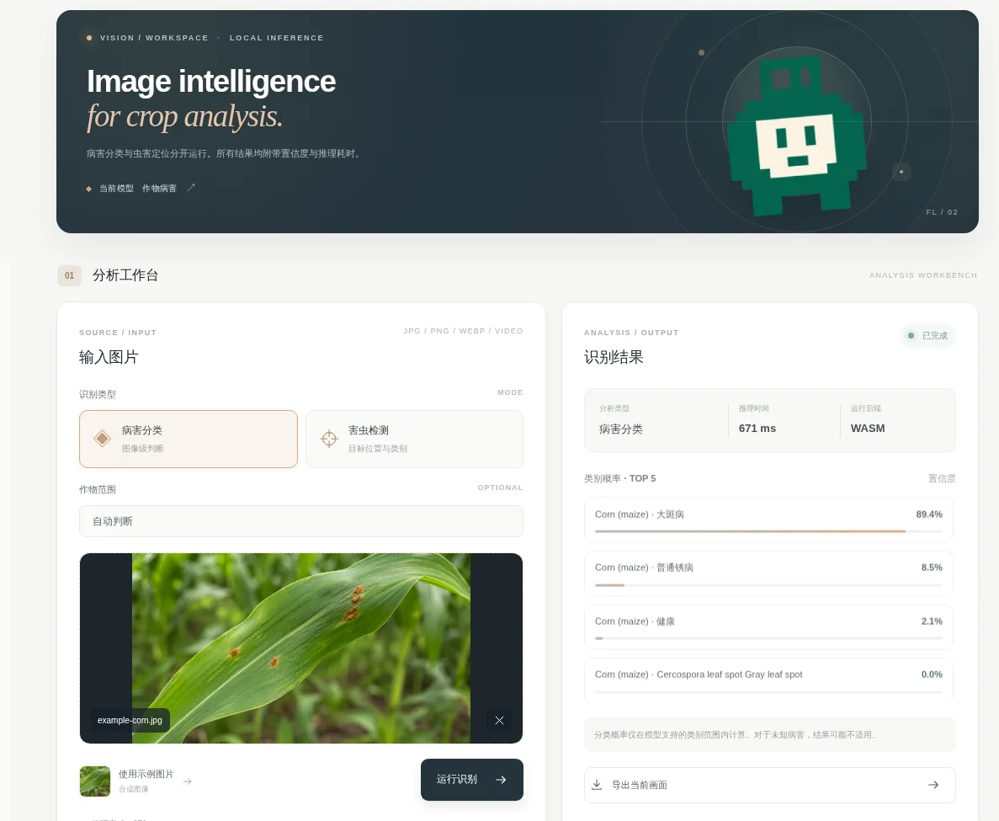

<div align="center">

<picture>
  <source media="(prefers-color-scheme: dark)" srcset="assets/readme-brand-dark.svg">
  <source media="(prefers-color-scheme: light)" srcset="assets/cover.svg">
  
</picture>

**作物病害图像分类 · 农业害虫目标检测**

浏览器本地推理 / Windows 桌面工作台

<p>
  <a href="https://github.com/cha290196-hue/FieldLens/releases/tag/desktop-v2.1.0"></a>
  <a href="https://github.com/cha290196-hue/FieldLens/actions/workflows/pages.yml"></a>
  <a href="https://github.com/cha290196-hue/FieldLens/actions/workflows/desktop.yml"></a>
  <a href="LICENSE"></a>
</p>

[**Web 在线演示**](https://cha290196-hue.github.io/FieldLens/) &nbsp; · &nbsp; [**Windows 安装包**](https://github.com/cha290196-hue/FieldLens/releases/download/desktop-v2.1.0/FieldLens-Setup-2.1.0-x64.exe) &nbsp; · &nbsp; [模型与数据](#模型与数据) &nbsp; · &nbsp; [本地构建](#本地构建)

</div>

---

## Windows Desktop

<div align="center">
  <a href="assets/desktop-workbench.jpg"></a>
</div>

<sub>Windows 2.1 实际推理画面。左侧管理图像，中央查看原图，右侧显示分类结果与置信度。点击图片可查看原尺寸。</sub>

[**下载 FieldLens 2.1.0 for Windows**](https://github.com/cha290196-hue/FieldLens/releases/download/desktop-v2.1.0/FieldLens-Setup-2.1.0-x64.exe) · [版本页面](https://github.com/cha290196-hue/FieldLens/releases/tag/desktop-v2.1.0)

Windows 10/11 x64。运行安装程序后，打开 FieldLens，添加图片，选择病害分类或害虫检测，再执行分析。**模型权重不包含在安装包内**，首次使用对应模型时会联网下载并校验 SHA-256；缓存完成后可离线使用。安装包未进行商业代码签名，Windows 可能显示 SmartScreen 提示。

## Web Demo

<div align="center">
  <a href="assets/web-demo.webp"></a>
</div>

<sub>Web Demo 实际运行截图（裁切）。浏览器加载 ONNX 模型并在设备本地执行推理。</sub>

[**打开 Web Demo**](https://cha290196-hue.github.io/FieldLens/)

选择任务、上传 JPG / PNG / WEBP 图片或视频并运行。病害分类输出图片级类别概率；害虫检测输出目标框、类别和置信度。浏览器使用 WebGPU（可用时）或 WASM，不需要远程图像推理服务。

## 功能范围

| | Web Demo | Windows Desktop 2.1 |
| :-- | :-- | :-- |
| 病害分类 | 14 种作物、38 类状态 | 59 种作物、387 类状态 |
| 害虫检测 | 102 类，输出检测框 | 102 类，输出检测框 |
| 输入 | 图片、视频当前帧 | JPG / PNG / WEBP 图片队列 |
| 结果 | 类别概率、置信度、推理时间 | 分析面板、图像缩放、推理时间 |
| 其他 | PNG 导出、浏览器历史记录 | 模型下载管理、本地历史记录、PNG 导出 |

> **结果类型不同：** 病害模型执行整张图片分类，不会标出病斑位置；害虫模型执行目标检测。模型未覆盖的类别、混合病害或复杂田间图像可能产生误判，结果用于辅助筛查。

## 模型与数据

| 任务 | 模型结构 | 数据集 | 类别数 | 公开评估记录 |
| :-- | :-- | :-- | --: | :-- |
| Web 病害分类 | DINOv2 ViT-S/14 + 分类头 | PlantVillage | 38 | 原始权重 Accuracy 98.9%；上游 INT8 98.7% |
| Windows 病害分类 | DINOv2 ViT-B/14 + 分类头 | PlantVillage、PlantWild v1/v2、多作物研究数据 | 387 | 去近重复测试集 92.9%；PlantWild 田间测试 74.7% |
| 害虫检测 | YOLO11s | IP102 | 102 | 验证集 mAP@0.5 0.815 |

这些是各权重发布方在其测试集上报告的指标，**不是 FieldLens 独立测得的准确率**；图像分类 Accuracy 与目标检测 mAP 不可横向比较。模型、数据集和训练资料的授权条件见 [第三方组件及许可证](THIRD_PARTY_NOTICES.md)，与本仓库源码许可证分别适用。

<details>
<summary><strong>Web 病害分类 · 训练与指标</strong></summary>

数据：PlantVillage 彩色叶片图像约 54,305 张；训练 43,443 张，测试 10,862 张；测试时隔离已识别的重复物理叶片。

训练：冻结 DINOv2-Small 视觉主干，拼接 CLS token 与 patch token 平均特征，训练多项逻辑回归分类头。输入 224 × 224。

| 测试 | Accuracy | Macro-F1 |
| :-- | --: | --: |
| 原始浮点权重，PlantVillage | 98.9% | 98.5% |
| 上游 INT8 ONNX，PlantVillage | 98.7% | 98.1% |

Web 当前部署采用保留浮点卷积、对部分矩阵运算做兼容量化的 ONNX 文件，**不能直接套用上述 INT8 权重指标**。PlantVillage 主要为受控环境叶片图片，不能据此推算田间准确率。

</details>

<details>
<summary><strong>Windows 病害分类 · 训练与指标</strong></summary>

数据：PlantVillage、PlantWild v1/v2 及多作物研究数据；训练 238,028 张，测试 28,328 张，其中去近重复子集 27,900 张。

训练：DINOv2 ViT-B/14，先训练分类头，再进行全模型微调；类别均衡采样和田间图像增强。输入 224 × 224，发布版为 ONNX 4-bit 权重量化。

| 测试集 | 数量 | Accuracy | Macro-F1 |
| :-- | --: | --: | --: |
| 去近重复测试子集 | 27,900 | 92.9% | 0.906 |
| 去近重复、已知作物 | 27,900 | 94.2% | 0.926 |
| PlantVillage 实验室照片 | 4,853 | 99.6% | 0.997 |
| 研究数据子集 | 20,144 | 94.0% | 0.926 |
| PlantWild 田间照片 | 2,983 | 74.7% | 0.744 |
| PlantWild 田间照片、已知作物 | 2,983 | — | 0.857 |

4-bit 量化版在公开的 280 张抽查图片中，与原 PyTorch 权重 Top-1 结果一致比例为 99.6%。这些数字不是跨设备或跨地区的产品性能保证。

</details>

<details>
<summary><strong>农业害虫检测 · 训练与指标</strong></summary>

数据：IP102，102 类农业害虫；公开训练记录描述了约 34,000 张平衡样本。

训练：YOLO11s，640 / 896 输入尺寸，77 Epoch，A100 GPU。软件默认按 640 × 640 导出推理模型。

| 指标 | 训练集 | 验证集 |
| :-- | --: | --: |
| Precision | 0.912 | 0.744 |
| Recall | 0.923 | 0.789 |
| mAP@0.5 | 0.941 | 0.815 |
| mAP@0.5:0.95 | 0.838 | 0.605 |

以上为公开权重自报指标。IP102 的类别和标注方式不等同于病害分类数据集。

</details>

## 本地构建

环境：**Node.js 22、Python 3.11**。用户直接体验时不需要这些开发工具。

### Web

```bash
npm install
npm test
npm run prepare-runtime
python -m pip install torch==2.6.0 torchvision==0.21.0 "numpy<2.3" ultralytics==8.3.120 onnx==1.17.0 onnxruntime==1.20.1
python scripts/prepare_models.py
python -m http.server 8000 --directory dist
```

打开 `http://localhost:8000`。运行模型准备脚本需要联网获取权重，下载与导出时间取决于网络及设备性能。

### Windows 安装包

在 Windows 10/11 x64 环境中运行：

```powershell
npm install
npm run prepare-runtime
python -m pip install pillow
python scripts/make_icon.py
npm run desktop:build
```

生成的 NSIS 安装程序位于 `release/`。自动构建与测试分别见 [Web 工作流](.github/workflows/pages.yml)、[Windows 工作流](.github/workflows/desktop.yml)。

<details>
<summary><strong>仓库目录</strong></summary>

| 路径 | 内容 |
| :-- | :-- |
| `dist/` | Web 页面与浏览器推理 |
| `desktop-ui/` | Windows 独立工作台界面 |
| `desktop/` | Electron 窗口及模型缓存 |
| `scripts/` | 模型准备、导出与测试 |
| `tests/` | 单元测试 |
| `.github/workflows/` | Web、Windows 构建与验证 |

</details>

## 许可证

仓库源码采用 [MIT License](LICENSE)。预训练模型、训练数据集和依赖组件受各自授权条款约束，详见 [THIRD_PARTY_NOTICES.md](THIRD_PARTY_NOTICES.md)。