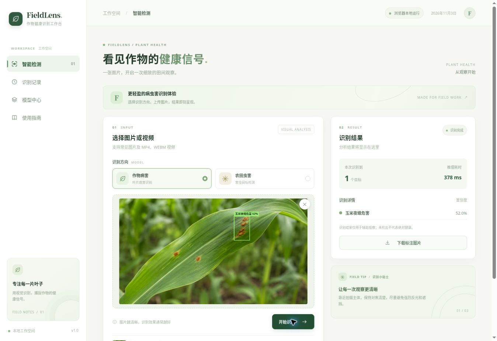
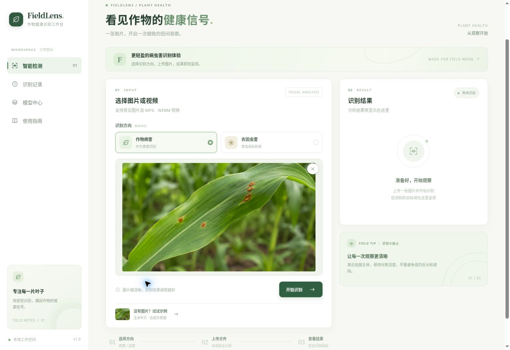
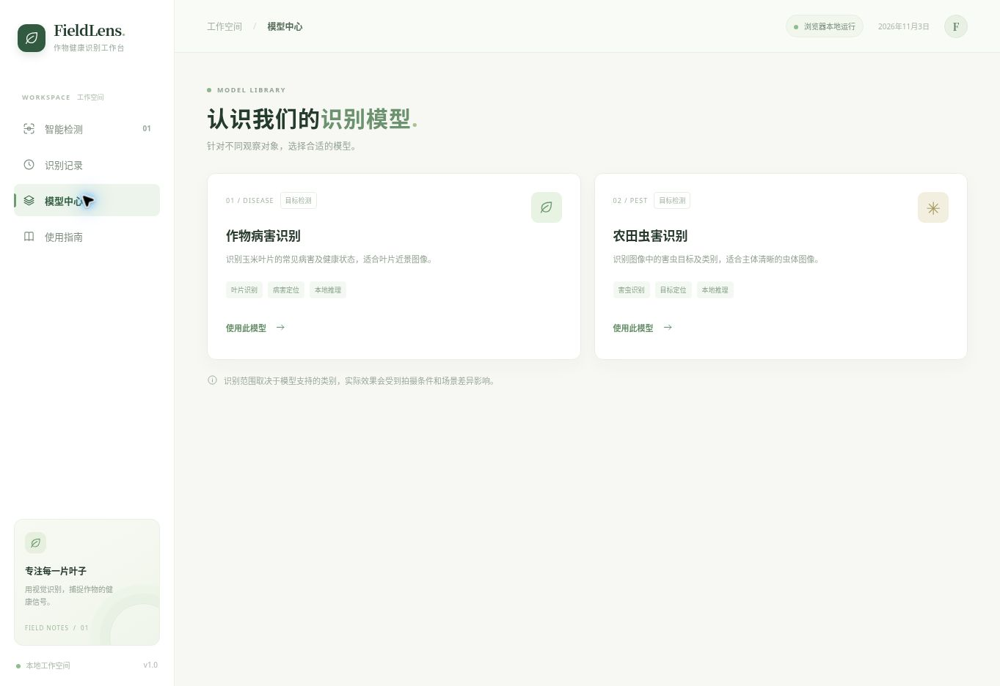
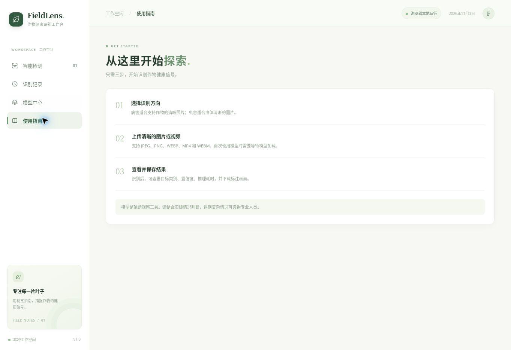
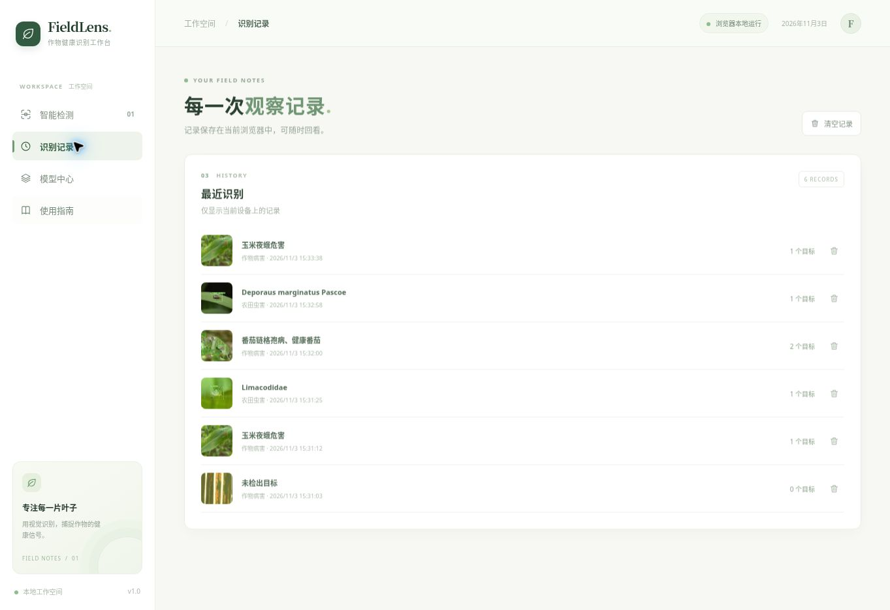

<p align="center"></p>

<p align="center"><strong>一张图片，开启一次细致的田间观察。</strong></p>
<p align="center">病害识别 · 害虫检测 · 本地推理 · 结果记录</p>

---

FieldLens 是一款面向作物健康观察的轻量视觉工作台。选择识别方向，上传图片或视频，即可查看目标的位置、类别、置信度与处理耗时。图片和识别记录保存在当前设备上。

在线演示可从仓库的部署页面打开。首次使用某个模型时，浏览器需要下载对应模型文件；识别在本机完成。

更新界面后，可在仓库的 Actions 中手动运行 `Publish demo`，刷新在线演示。

## 工作台预览

<p align="center"><br><sub>内置合成示意图的实际推理画面；检测结果不代表准确诊断。</sub></p>

<table><tr><td width="50%"><br><strong>图片输入</strong><br>拖放上传，或载入合成示例图。</td><td width="50%"><br><strong>模型中心</strong><br>在病害识别与害虫检测之间切换。</td></tr></table>

<p align="center"></p>

<p align="center"></p>

## 功能

| 功能 | 说明 |
| --- | --- |
| 病害识别 | 定位玉米、番茄、水稻、茶叶的部分病害及相关目标，共 28 类 |
| 害虫检测 | 定位虫体并显示类别与置信度，共 102 类 |
| 图片与视频 | 图片单次分析；视频按可处理的帧逐帧分析 |
| 本地运行 | 推理在浏览器中执行，使用可用的计算后端 |
| 识别记录 | 在当前浏览器保存最近的识别摘要 |
| 导出画面 | 下载当前带检测框的图片或视频画面 |
| 关注提示 | 检出疑似异常时给出本地复查提示 |
| 评估工具 | 对有标注的数据计算 mAP、精确率与召回率 |

示例图为合成示意图，仅用于体验操作流程；模型性能应在独立、带标注的真实样本上评估。真实照片可能出现漏检和误分类，识别结果仅供辅助观察。

## 在本地运行

需要 Node.js 20 及以上；准备或评估模型时还需要 Python 3.11。

```bash
npm install --no-package-lock
npm run prepare-runtime
```

从本仓库的模型发布包取得 `disease.pt` 和 `pest.pt`，放入 `models/` 目录后，导出浏览器使用的模型：

```bash
pip install torch==2.6.0 torchvision==0.21.0 "numpy<2.3" ultralytics==8.3.120 onnx==1.17.0
python scripts/export_models.py --disease models/disease.pt --pest models/pest.pt
python -m http.server 8000 --directory dist
```

浏览器打开 `http://localhost:8000`。首次加载模型需要等待；WebGPU 不可用时会尝试使用 WebAssembly。

也可以直接在本地对图片或视频运行检测。`--device cpu` 使用 CPU，支持 CUDA 的设备可使用 `--device 0`：

```bash
python scripts/predict.py --model models/disease.pt --input image.jpg --device cpu
```

单张图片可用于检查速度，但不能据此得出模型准确率。可在实际设备上重复测量推理耗时：

```bash
python scripts/benchmark.py --model models/disease.pt --image image.jpg --device cpu --runs 30
```

## 模型评估

使用带边界框标注的数据集，并在数据配置中指定测试集：

```bash
python scripts/evaluate.py --model models/disease.pt --data dataset.yaml --split test --device cpu
```

结果输出到 `evaluation.json`。对测试集样本的数量、类别和采集条件应如实记录；不同数据集上的指标不能直接比较。

几张图片适合检查流程，不能代表模型整体性能。要估计 mAP、精确率和召回率，需要独立且有边界框标注的测试样本。

## 按需训练

演示直接使用已训练权重，不需要训练集。如果课程要求重新训练，可准备带边界框标注、并划分好训练集和验证集的数据，类别及编号需与所选权重一致，然后运行：

```bash
python scripts/train.py --model models/disease.pt --data dataset.yaml --epochs 30 --batch 8 --device 0
```

训练完成后，再使用独立测试集执行评估。训练和评估结果必须以实际运行记录为准。

## 结构

```text
FieldLens/
├── dist/                 浏览器界面与推理逻辑
├── scripts/              模型导出、评估与本地推理
├── tests/                目标框解码和后处理检查
├── docs/                 项目界面截图
├── models/               本地模型文件位置
└── .github/workflows/    演示构建流程
```

## 校验

```bash
npm test
```

---

<p align="center"><sub>FIELDLENS &nbsp; / &nbsp; OBSERVE · UNDERSTAND · GROW</sub></p>
